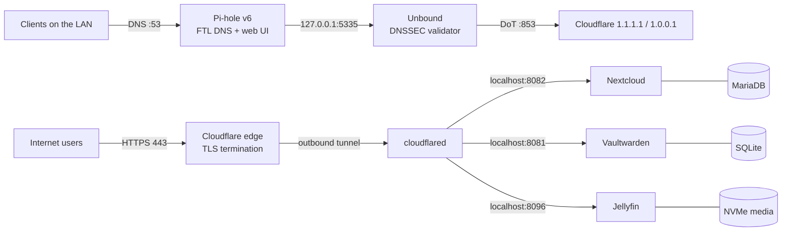

# Raspberry Pi 5 Homelab

Documentation of a Raspberry Pi 5 that runs a full self-hosted stack:

- **Pi-hole v6** as the LAN DNS server and ad blocker
- **Unbound** as a local DNSSEC-validating resolver / DNS-over-TLS forwarder
- **Cloudflare Tunnel** for public HTTPS access without opening router ports
- **Nextcloud** for files, calendar, contacts, notes and mail
- **Vaultwarden** for passwords
- **Jellyfin** for media streaming

## Placeholders

| Placeholder | Meaning |
| --- | --- |
| `192.168.1.10` | Raspberry Pi LAN address (real address redacted) |
| `192.168.1.1` | Router / gateway |
| `example.com` | Public domain managed in Cloudflare (real domain redacted) |
| `cloud.example.com` | Nextcloud hostname |
| `vault.example.com` | Vaultwarden hostname |
| `media.example.com` | Jellyfin hostname |
| `/home/pi` | Home directory of the admin user |
| `pi` | Admin username |

## Architecture



DNS and web traffic are deliberately separated:

- **DNS is local-only.** Pi-hole listens on port 53 and is not exposed to the internet.
- **Web services are outbound-only.** `cloudflared` creates an outbound tunnel to
  Cloudflare, so no inbound ports are forwarded on the router. Cloudflare terminates
  TLS and forwards plain HTTP to services bound to `localhost`.

## Services

| Service | Version | Local port | Public hostname | Exposure |
| --- | --- | --- | --- | --- |
| Pi-hole Core / Web / FTL | 6.4.3 / 6.6 / 6.7 | 53, 80, 443 | – | LAN only |
| Unbound | 1.17.1 | 127.0.0.1:5335 | – | Localhost only |
| cloudflared | 2026.10.5 | outbound | – | Outbound tunnel |
| Nextcloud | 32.0.1 | 8082 | `cloud.example.com` | Public via tunnel |
| MariaDB | 10.6.24 | internal | – | Docker network |
| Vaultwarden | 1.37.1 | 127.0.0.1:8081, :3012 | `vault.example.com` | Public via tunnel |
| Jellyfin | 10.10.7 | 8096 (host network) | `media.example.com` | Public via tunnel |

## Hardware and OS

| Item | Value |
| --- | --- |
| Board | Raspberry Pi 5 Model B Rev 1.0 |
| RAM | 8 GB |
| OS | Debian GNU/Linux 12 (bookworm), Raspberry Pi kernel 6.12 |
| Architecture | `aarch64` |
| Root disk | 58.2 GB microSD (`/dev/mmcblk0p2`, 57.7 GB ext4) |
| Data disk | 465.8 GB NVMe SSD (`/dev/nvme0n1p1`) mounted at `/mnt/myssd` |
| Network | Ethernet, static `192.168.1.10/24`, IPv6 SLAAC |

## Repository layout

```text
.
├── README.md
├── docs/
│   ├── 01-hardware-and-os.md
│   ├── 02-network.md
│   ├── 03-dns-pihole-unbound.md
│   ├── 04-cloudflare-tunnel.md
│   ├── 05-nextcloud.md
│   ├── 06-vaultwarden.md
│   ├── 07-jellyfin.md
│   └── 11-rebuild-runbook.md
├── configs/
│   ├── unbound/
│   ├── pihole/
│   ├── cloudflared/
│   ├── nextcloud/
│   ├── vaultwarden/
│   ├── jellyfin/
│   └── network/
└── scripts/
    └── healthcheck.sh
```

## How it works, in one paragraph

Clients on the LAN send DNS queries to Pi-hole. Pi-hole applies blocklists and forwards
everything else to Unbound on `127.0.0.1:5335`. Unbound validates DNSSEC with the root
trust anchor and forwards queries over DNS-over-TLS to Cloudflare. Separately,
`cloudflared` maintains an outbound tunnel to Cloudflare; Cloudflare maps three public
hostnames to three local HTTP services. Nextcloud and its MariaDB run in Docker with
bind-mounted data on the SD card. Vaultwarden runs in Docker, bound to localhost, with
SQLite data. Jellyfin runs with host networking and reads media from the NVMe SSD.

## Start here

- New to the project? Read [docs/11-rebuild-runbook.md](docs/11-rebuild-runbook.md).
- Want the DNS details? Read [docs/03-dns-pihole-unbound.md](docs/03-dns-pihole-unbound.md).

## Disclaimer

This is a personal homelab, not a production reference architecture. The documentation
is provided as-is. Review every command and configuration before applying it to your own
system, and never commit secrets, tunnel credentials or private keys.
